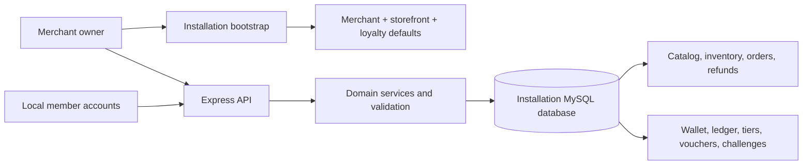

# Installation and Commerce Architecture

Each running IncomSG instance connects to a dedicated database for one merchant. The `Merchant` record is the installation root used by merchant CMS, member storefront, orders, loyalty, and reporting.

## Installation bootstrap

The backend seed reads `MERCHANT_OWNER_EMAIL`, `MERCHANT_OWNER_PASSWORD`, `MERCHANT_NAME`, and `MERCHANT_SLUG`. It creates the merchant owner account, the installation's `Merchant` record, default storefront draft and published version, a `LoyaltyRule`, four baseline tiers, and the first loyalty policy version. It never seeds demo accounts, member accounts, orders, or catalog data. Re-running it fills missing baseline configuration only after confirming the configured owner and store match the existing root.

The bootstrap stops if the database already has multiple merchants or if the configured email belongs to a different account. It does not change existing user roles or credentials. Keep owner credentials in a secret manager or an ignored application `.env` file.

## Order and loyalty transaction flow

1. Member creates a pending order. The backend reads catalog prices, computes totals, snapshots order items, and reserves inventory and any discount voucher.
2. Member requests Mock payment. The backend conditionally changes the order from `PENDING` to `PAID` and commits inventory, voucher, points, tier, and challenge changes in the same transaction.
3. Duplicate payment requests cannot create a second earning because settlement claims only a pending order and ledger references are unique.
4. A member may request a refund for a paid order. The merchant owner performs the final decision; approving records a synthetic completed refund and reverses the associated points and challenge effects while restoring the applicable voucher.

Mock payment and refunds are application behavior only. Neither action collects nor returns real funds.

## Data and access boundaries

- Merchant APIs resolve the merchant from the authenticated owner account.
- Member APIs scope orders and wallets to the authenticated member and the installation's merchant.
- Order totals and all payment, refund, points, tier, voucher, inventory, and challenge outcomes come from backend persistence.
- `PointTransaction` is the balance audit trail. Wallet projections use decimal balances and do not rewrite history.

The source implementation lives under [`apps/backend/src/modules`](../../apps/backend/src/modules), with schema and forward-only migrations under [`apps/backend/prisma`](../../apps/backend/prisma). Historical implementation notes under `docs/superpowers` describe earlier milestones and are not the current runtime contract.
