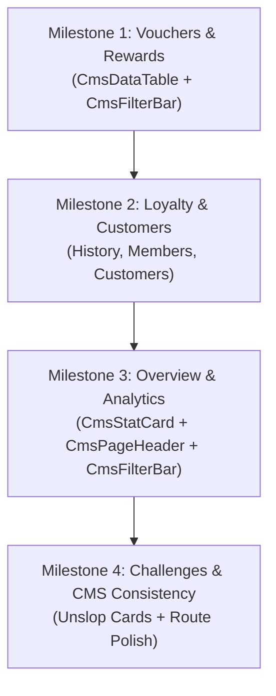

# Kế Hoạch Chuẩn Hóa UI/UX Merchant CMS Theo Chuẩn Shopify Admin & Ant Design 6

- **Ngày cập nhật:** 26/11/2026
- **Vị trí tài liệu:** `docs/superpowers/plans/2026-11-26-merchant-cms-ux-redesign-plan.md`
- **Dự án:** IncomSG — Loyalty & Commerce Platform
- **Tài liệu tham chiếu chuẩn xác:**
  - Thiết kế gốc CMS: [docs/superpowers/specs/historical/2026-11-17-merchant-cms-redesign-design.md](/docs/superpowers/specs/historical/2026-11-17-merchant-cms-redesign-design.md)
  - Quy chuẩn toàn kho: [AGENTS.md](/AGENTS.md)
  - Kiến trúc hệ thống: [agent-docs/ARCHITECTURE.md](/agent-docs/ARCHITECTURE.md)
  - Quy chuẩn giao diện: [agent-docs/UI_UX_GUIDELINES.md](/agent-docs/UI_UX_GUIDELINES.md)

---

## 1. Bối Cảnh Thực Tế & Nhìn Lại Lộ Trình Gốc

Theo tài liệu đặc tả thiết kế gốc của dự án (`2026-11-17-merchant-cms-redesign-design.md`):
- **Tầm nhìn thiết kế (Design Intent):** Xây dựng cho Merchant một giao diện vận hành nhất quán, gọn gàng và nhỏ gọn (compact operations UI) lấy cảm hứng từ **Shopify Admin** và **Ant Design Pro**, sử dụng bộ component Ant Design 6 và theme trung tính riêng cho Merchant (`merchantCmsTheme.tsx`).
- **8 Pattern CMS chuẩn dùng chung (Canonical Reusable CMS Patterns):**
  1. `CmsPageHeader`: Tiêu đề trang, breadcrumb tự động và khu vực action cô đọng.
  2. `CmsDataTable`: Bọc Ant Design `Table` có định kiểu chặt chẽ, xử lý thanh cuộn ngang, trạng thái rỗng và tải dữ liệu.
  3. `CmsFilterBar`: Thanh lọc tìm kiếm gọn gàng, hoạt động tốt trên cả màn hình nhỏ.
  4. `CmsStatusTag`: Nhãn trạng thái ngữ nghĩa dùng chung (tiếng Việt chuẩn nghiệp vụ).
  5. `CmsDetailLayout`: Bố cục xem chi tiết chuẩn có nút quay lại danh sách (`backTo`).
  6. `CmsFormDrawer`: Drawer trượt cho các thao tác chỉnh sửa nhanh.
  7. `CmsConfirmAction`: Modal xác nhận qua Popconfirm bảo đảm an toàn dữ liệu.
  8. `CmsStatCard`: Thẻ hiển thị chỉ số lấy từ API backend thực tế.

### Thực Trạng Hiện Tại (Khoảng Trống Cần Hoàn Thiện):
Dự án đã hoàn thành chuyển đổi cho **Đơn hàng (`MerchantOrders`)**, **Hoàn tiền (`MerchantRefundRequestsPage`)**, và **Sản phẩm (`MerchantProductsPage`)**.
Tuy nhiên, các phân hệ còn lại đang bị **bỏ dở nửa chừng**, dẫn tới tình trạng "nửa nạc nửa mỡ" (chỗ thì dùng Ant Design chuẩn, chỗ thì tự viết `<table>` thô, chỗ thì dùng `components/ui` tự chế với mã hex cắm cứng):
1. **Voucher & Quà tặng:** `MerchantVouchersTable` vẫn dùng thẻ `<table>` thô sơ với `uppercase tracking-[.08em]`.
2. **Khách hàng & Hội viên:** `MerchantCustomersPage` và `CustomerHistorySections` dùng `<table>` thô và thẻ div giả lập bảng.
3. **Lịch sử & Thành viên Loyalty:** `MerchantLoyaltyHistory` và `MerchantLoyaltyMembers` dùng `<table>` thô.
4. **Tổng quan & Báo cáo:** `BackendMerchantOverviewPage` và `MerchantAnalyticsPage` (`AnalyticsProductTables`) vẫn dùng `StatCard` và `PageHeader` tự chế thay vì `CmsStatCard`, `CmsPageHeader`, `CmsFilterBar`.
5. **Thử thách (Challenges):** `MerchantChallengeCard` và `MerchantChallengesPage` lạm dụng hiệu ứng hover dập dềnh (`hover:shadow-[]`), nhãn in hoa kéo dãn (`uppercase tracking-[.08em] MỤC TIÊU`).

---

## 2. Lộ Trình 4 Cột Mốc Hoàn Thiện Chuẩn Hóa (Milestones)

Lộ trình này bám sát 100% mục tiêu của `Later Milestones` trong tài liệu thiết kế gốc, chuyển đổi từng màn hình dứt điểm, bảo đảm an toàn và không làm đứt gãy API hay logic nghiệp vụ hiện có.

---

### Milestone 1: Chuẩn Hóa Danh Sách Voucher & Hàng Chờ Đổi Quà (Vouchers & Rewards)
**Phạm vi file:**
- `apps/frontend/src/features/merchant/MerchantVouchersTable.tsx`
- `apps/frontend/src/features/merchant/MerchantVoucherTableRow.tsx`
- `apps/frontend/src/features/merchant/backend/BackendMerchantVouchersPage.tsx`

**Công việc cụ thể:**
1. Thay thế thẻ `<table>` thô trong `MerchantVouchersTable` bằng `CmsDataTable`.
2. Định nghĩa các cột chuẩn bằng `TableColumnsType`:
   - Tên voucher & Icon đại diện.
   - Loại voucher (`DISCOUNT` vs `REWARD_PRODUCT`) dùng `CmsStatusTag`.
   - Điểm đổi (`font-mono tabular-nums`).
   - Tồn kho / Lượt phát hành (`tabular-nums`).
   - Trạng thái hoạt động (Switch hoặc Action button).
   - Thao tác: Chỉnh sửa / Chi tiết.
3. Xóa bỏ hoàn toàn header `uppercase tracking-[.08em]`.
4. Chuẩn hóa thanh tìm kiếm và lọc loại voucher bằng `CmsFilterBar`.

**Kiểm thử nghiệm thu:**
- Chạy `tests/frontend/unit/merchant/merchant-vouchers-layout.test.tsx` và `merchant-voucher-status.test.tsx` pass 100%.

---

### Milestone 2: Chuẩn Hóa Quản Lý Hội Viên & Lịch Sử Chính Sách (Loyalty & Customers)
**Phạm vi file:**
- `apps/frontend/src/features/customers/MerchantCustomersPage.tsx`
- `apps/frontend/src/features/customers/CustomerHistorySections.tsx`
- `apps/frontend/src/features/merchant/MerchantLoyaltyHistory.tsx`
- `apps/frontend/src/features/merchant/MerchantLoyaltyMembers.tsx`

**Công việc cụ thể:**
1. **Màn hình Khách hàng (`MerchantCustomersPage`):**
   - Chuyển bảng hội viên sang `CmsDataTable`.
   - Hiển thị badge Hạng thẻ (`BRONZE`, `SILVER`, `GOLD`) trang nhã bằng `CmsStatusTag`.
   - Cột Điểm tích lũy và Tổng chi tiêu căn phải `text-right font-mono tabular-nums`.
   - Dùng `CmsFilterBar` cho ô tìm kiếm SĐT/Email và dropdown lọc hạng thẻ.
2. **Lịch sử chính sách (`MerchantLoyaltyHistory`):**
   - Chuyển bảng các phiên bản chính sách sang `CmsDataTable`.
   - Thể hiện rõ phiên bản hiện hành (`CmsStatusTag` màu xanh cho `Đang áp dụng`) và các phiên bản cũ (`Chỉ đọc`).
3. **Danh sách thành viên Loyalty (`MerchantLoyaltyMembers`):**
   - Chuyển sang `CmsDataTable` đồng bộ.

**Kiểm thử nghiệm thu:**
- Chạy `tests/frontend/unit/analytics/customer-analytics.test.tsx` và `loyalty-policy-history-ui.test.tsx` pass 100%.

---

### Milestone 3: Chuẩn Hóa Màn Hình Tổng Quan & Báo Cáo Phân Tích (Overview & Analytics)
**Phạm vi file:**
- `apps/frontend/src/features/merchant/backend/BackendMerchantOverviewPage.tsx`
- `apps/frontend/src/features/analytics/MerchantAnalyticsPage.tsx`
- `apps/frontend/src/features/analytics/AnalyticsProductTables.tsx`

**Công việc cụ thể:**
1. **Màn hình Tổng quan (`BackendMerchantOverviewPage`):**
   - Thay thế `PageHeader` và `StatCard` tự chế bằng `CmsPageHeader` và `CmsStatCard`.
   - Giữ nguyên biểu đồ `MerchantRevenueChart` (uPlot) và luồng API thực tế.
2. **Màn hình Phân tích (`MerchantAnalyticsPage`):**
   - Đưa form lọc ngày (`from`, `to`, `granularity`) vào `CmsFilterBar` gọn gàng, căn thẳng hàng chân đế, không bị tràn màn hình.
   - Thay thế các thẻ KPI bằng `CmsStatCard`.
   - Chuyển đổi bảng Top sản phẩm (`AnalyticsProductTables`) từ thẻ `<table>` thô sang `CmsDataTable`, doanh thu và số lượng căn phải chuẩn xác.

**Kiểm thử nghiệm thu:**
- Chạy `tests/frontend/unit/analytics/customer-analytics.test.tsx` pass 100%.

---

### Milestone 4: Tinh Chỉnh Thử Thách & Đồng Bộ Nhất Quán Toàn Bộ CMS (Challenges & Consistency)
**Phạm vi file:**
- `apps/frontend/src/features/merchant/challenges/MerchantChallengesPage.tsx`
- `apps/frontend/src/features/merchant/challenges/MerchantChallengeCard.tsx`
- `apps/frontend/src/features/merchant/challenges/ChallengeParticipantsPanel.tsx`
- `apps/frontend/src/layouts/BackendConsoleLayout.tsx`

**Công việc cụ thể:**
1. **Dọn dẹp Slop trong `MerchantChallengeCard`:**
   - Xóa bỏ `hover:shadow-[0_20px_46px_rgba(39,62,42,.09)]` và `hover:-translate-y-0.5`.
   - Xóa bỏ nhãn in hoa kéo dãn `uppercase tracking-[.08em] MỤC TIÊU`.
   - Thay thế các mã màu hex cắm cứng bằng CSS tokens (`var(--color-ink)`, `var(--color-muted)`,...).
   - Dùng `CmsStatusTag` hiển thị trạng thái chiến dịch.
2. **Bảng người tham gia (`ChallengeParticipantsPanel`):**
   - Chuyển đổi sang `CmsDataTable`.
3. **Rà soát Khung Bố Cục (`BackendConsoleLayout`):**
   - Kiểm tra active state của 7 nhóm menu Sidebar.
   - Kiểm tra breadcrumbs hiển thị chính xác trên toàn bộ các route sâu.

**Kiểm thử nghiệm thu:**
- Chạy `tests/frontend/unit/challenges/challenges-merchant.test.tsx` và `navigation-ux.test.tsx` pass 100%.
- Chạy toàn bộ test suite frontend `npm run test:frontend` pass 33/33 files.
