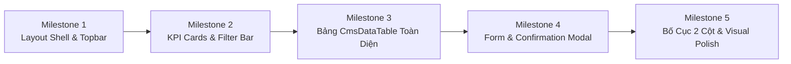

# Kế Hoạch Nâng Cấp Toàn Diện UI/UX Merchant CMS (IncomSG)

- **Ngày lập:** 26/11/2026
- **Vị trí tài liệu:** `docs/superpowers/plans/2026-11-26-merchant-cms-ux-redesign-plan.md`
- **Dự án:** IncomSG — Loyalty & Commerce Platform
- **Mục tiêu:** Xóa bỏ hoàn toàn cảm giác chắp vá, nghèo nàn của giao diện quản trị Merchant CMS; nâng cấp lên đẳng cấp công cụ quản trị bán lẻ B2B chuyên nghiệp (Clean, Quiet, High-Craft, Utilitarian) tuân thủ nghiêm ngặt [AGENTS.md](/AGENTS.md) Mục 5 và [UI_UX_GUIDELINES.md](/agent-docs/UI_UX_GUIDELINES.md).

---

## 1. Phân Tích Thực Trạng & Điểm Yếu Cốt Lõi (UX Audit)

Qua rà soát chuyên sâu toàn bộ module `apps/frontend/src/features/merchant/`, `layouts/BackendConsoleLayout.tsx`, và các trang liên quan, phát hiện 5 vấn đề cốt tử khiến trải nghiệm CMS bị đánh giá là "quá kém":

1. **Khung giao diện (Layout Shell) thô sơ và thiếu tiện ích quản trị:**
   - **Sidebar:** Danh mục menu dài nhưng phân cấp thị giác yếu; trạng thái active chưa đủ nổi bật; thiếu badge thông báo (ví dụ: số đơn chờ xử lý, số yêu cầu hoàn tiền).
   - **Topbar:** Chỉ có thanh Breadcrumb đơn điệu; hoàn toàn thiếu **Chỉ báo Chi nhánh (Branch Context)** — vi phạm quy chuẩn `UI_UX_GUIDELINES.md` Mục 2.2 ("Luôn hiển thị rõ ràng chỉ báo chi nhánh hiện tại"); thiếu trạng thái ca quầy thu ngân và profile menu.
2. **Bộ lọc & Thanh công cụ tìm kiếm (Filter & Action Bars) phân mảnh:**
   - Mỗi trang viết form tìm kiếm một kiểu (chỗ dùng grid 6 cột nhồi nhét, chỗ dùng inline flex bị tràn mobile/tablet).
   - Nút "Tìm kiếm" bị thụt đáy hoặc lệch dòng so với các ô input.
   - Thiếu trải nghiệm lọc mượt (debounce search, clear filter nhanh).
3. **Thẻ thống kê KPI (Stat Cards) thô ráp:**
   - Số liệu quá to, lạm dụng `font-extrabold tracking-[-.06em]` gây dính nét.
   - Thiếu ngữ cảnh so sánh (không có nhãn phụ giải thích khoảng thời gian hoặc tỉ lệ biến động).
4. **Bảng dữ liệu (Data Tables) thiếu tính chuyên nghiệp:**
   - Vẫn còn 9 màn hình dùng `<table>` thô tự chế với header in hoa kéo dãn (`uppercase tracking-[.08em]`).
   - Căn chỉnh cột lộn xộn: Số tiền và điểm số chưa được căn phải (`text-right font-mono`), các cột trạng thái bị dạt sang trái, thao tác hành động thiếu menu dropdown gọn gàng.
5. **Màn hình chi tiết (Detail Views) dàn trải, kém scannability:**
   - Thông tin khách hàng, đơn hàng, cửa hàng hiển thị thành các khối chữ trải dài từ mép này sang mép kia màn hình, rất khó quét bằng mắt trên màn hình lớn.
   - Thiếu cấu trúc bố cục 2 cột (Main Column 65% + Side Card 35%) chuẩn mực của các hệ thống B2B/SaaS hiện đại.

---

## 2. Lộ Trình 5 Cột Mốc Triển Khai (Phased Milestones)

---

### Milestone 1: Khung Bố Cục Chuẩn Mực (CMS Layout Shell & Topbar Overhaul)
**Mục tiêu:** Tạo nên "bộ khung" chuyên nghiệp, vững chãi và tiện nghi cho toàn bộ trải nghiệm Merchant.

- **Nhiệm vụ cụ thể:**
  1. **Nâng cấp Topbar trong `BackendConsoleLayout.tsx`:**
     - Tích hợp **Branch Context Badge** hiển thị chi nhánh hiện tại (ví dụ: `"Chi nhánh A · Hikari Trung Tâm"` kèm dropdown đổi chi nhánh).
     - Bổ sung chỉ báo trạng thái kết nối & tài khoản thu ngân/chủ cửa hàng.
     - Breadcrumb thanh lịch với phân cách icon nhẹ nhàng (`CaretRight size={14}`).
  2. **Tối ưu Sidebar Điều Hướng:**
     - Làm rõ 7 nhóm menu: Vận hành, Sản phẩm, Cửa hàng, Khách hàng, Loyalty, Marketing, Báo cáo.
     - Thêm badge đếm số lượng cho các mục có việc cần làm (ví dụ: `Hoàn tiền` hiện số `2` màu cam nhẹ nếu có yêu cầu pending).
     - Active indicator: Nền xanh nhạt `--color-brand-subtle` (`#edf4ec`), chữ xanh đậm `--color-brand` (`#356b43`), vạch nhấn bên trái 3px.
  3. **Container Nội Dung Chuẩn (`PageShell`):**
     - Đặt max-width `max-w-7xl`, padding đồng nhất `p-6 lg:p-8`, xử lý cuộn trang êm ái.
- **Tiêu chí nghiệm thu:**
  - Layout hiển thị hoàn hảo từ màn hình laptop (1366px), desktop (1920px) đến tablet POS (1024px).
  - Không có thanh cuộn ngang ngoài ý muốn.
  - Các bài test điều hướng `tests/frontend/unit/storefront/navigation-ux.test.tsx` tiếp tục pass 100%.

---

### Milestone 2: Bộ Thẻ Chỉ Số KPI & Bộ Lọc Nhanh (Metric Cards & Unified Filter Bar)
**Mục tiêu:** Thống nhất toàn bộ thanh công cụ lọc và thẻ số liệu trên khắp các màn hình Overview, Analytics, Transactions, Orders.

- **Nhiệm vụ cụ thể:**
  1. **Tái thiết kế `CmsStatCard` / `StatCard`:**
     - Thiết kế theo tỉ lệ vàng: Nhãn trên cùng (`text-xs font-medium text-muted`), số liệu trung tâm (`text-2xl font-bold font-mono tracking-tight text-ink`), nhãn ghi chú dưới đáy (`text-xs text-muted-light`).
     - Bỏ `font-extrabold` và tracking âm thô bạo.
     - Icon tinh gọn nằm gọn gàng góc trên bên phải trong nền bo tròn 8px.
  2. **Chuẩn hóa Component `CmsFilterBar`:**
     - Thiết kế thanh lọc ngang gọn gàng: Ô tìm kiếm từ khóa (Keyword Search with clear button) + Bộ chọn khoảng ngày (Date Range) + Dropdown trạng thái + Nút xuất bản/Tạo mới (Primary Action nằm ngoài cùng bên phải).
     - Căn thẳng hàng chân đế (baseline alignment), loại bỏ hoàn toàn tình trạng nút tìm kiếm bị rớt dòng.
- **Tiêu chí nghiệm thu:**
  - Áp dụng thành công trên `MerchantOverview` và `MerchantAnalyticsPage`.
  - Bộ lọc hoạt động tức thì, không giật lag.

---

### Milestone 3: Đồng Bộ Toàn Bộ Bảng Dữ Liệu Còn Lại Sang `CmsDataTable` (Table Modernization)
**Mục tiêu:** Xóa sổ 100% các bảng `<table>` tự chế chắp vá và dọn sạch 15 vị trí dính nhãn in hoa kéo dãn.

- **Danh sách 4 màn hình trọng tâm chuyển đổi:**
  1. `MerchantVouchersTable.tsx`: Chuyển danh sách voucher định nghĩa sang `CmsDataTable`, hiển thị icon voucher, điểm đổi, tiến độ phát hành thanh lịch.
  2. `MerchantCustomersPage.tsx`: Chuyển bảng hội viên sang `CmsDataTable`, hiển thị hạng thẻ (Tier Badge), số dư điểm, tổng chi tiêu căn phải `text-right`.
  3. `MerchantLoyaltyHistory.tsx`: Chuyển bảng lịch sử phiên bản chính sách sang `CmsDataTable`, hiển thị rõ trạng thái `ACTIVE` vs `HISTORY`, người xuất bản.
  4. `AnalyticsProductTables.tsx`: Chuyển bảng Top sản phẩm bán chạy sang `CmsDataTable` với số lượng và doanh thu căn phải rõ ràng.
- **Quy chuẩn dữ liệu bảng:**
  - Header: Nền `#edf3ee`, chữ `#20392a`, font-weight 600, không uppercase tracking.
  - Cột tiền VND / Điểm: Bắt buộc `text-right font-mono tabular-nums`.
  - Cột mã đơn / ID: Hiển thị dạng badge mờ nhẹ (`#f0f4ee font-mono text-xs`).
  - Action Column: Nằm ngoài cùng bên phải, dùng button nhỏ (size="small") hoặc Dropdown menu ba chấm.
- **Tiêu chí nghiệm thu:**
  - 100% bảng trong CMS dùng chung một kiểu render, pagination và responsive x-scroll.
  - Bộ test `customer-analytics.test.tsx`, `merchant-vouchers-layout.test.tsx`, `loyalty-policy-history-ui.test.tsx` pass 100%.

---

### Milestone 4: Chuẩn Hóa Form Nhập Liệu & Modal Xác Nhận Nghiệp Vụ (Forms & Safety Modals)
**Mục tiêu:** Bảo vệ dữ liệu tài chính/loyalty theo AGENTS.md Mục 4 & 5, đồng thời tạo trải nghiệm điền form mượt mà.

- **Nhiệm vụ cụ thể:**
  1. **Đồng bộ Form Controls:**
     - Thiết lập chuẩn Input, Select, DatePicker, Switch trong Ant Design theme: Chiều cao `h-9` (36px), bo góc 8px, viền `#e3e9e2`, focus viền xanh rừng `#356b43`.
     - Nhãn form (Label): Đặt phía trên, font chữ 13px đậm vừa (`font-medium text-[#20392a]`), hiển thị dấu sao đỏ nếu bắt buộc.
  2. **Nâng Cấp Modal Xác Nhận Nghiệp Vụ (`ConfirmActionDialog` / `CmsConfirmAction`):**
     - Đảm bảo 100% các hành động: Hủy đơn, Hoàn tiền, Xuất bản chính sách mới, Bật/Tắt voucher đều mở Modal xác nhận rõ ràng.
     - Cấu trúc Modal:
       - Header có icon cảnh báo theo mức độ (Vàng cho cập nhật, Đỏ cho xóa/hủy).
       - Nội dung nêu rõ: **Đối tượng tác động** (Target) và **Hậu quả nghiệp vụ thực tế** (Material Effect: số tiền hoàn, số điểm điều chỉnh).
       - Nút xác nhận chỉ cho phép bấm khi dữ liệu hợp lệ; chống double-click tức thì.
  3. **Toast Notifications:**
     - Thông báo thành công/thất bại nhẹ nhàng ở góc phải trên (Antd `message` hoặc Radix Toast) thay vì hiển thị toàn trang gây gián đoạn.
- **Tiêu chí nghiệm thu:**
  - Không có bất kỳ thao tác xóa/hủy/cập nhật nào xảy ra khi chưa bấm xác nhận trong Modal.

---

### Milestone 5: Tối Ưu Bố Cục Màn Hình Chi Tiết 2 Cột (Scannable Detail Views & Polish)
**Mục tiêu:** Hoàn thiện giao diện chi tiết, loại bỏ tình trạng chữ dàn trải, tối ưu cho mắt quét của thu ngân và quản lý.

- **Nhiệm vụ cụ thể:**
  1. **Bố cục 2 cột (Master-Detail Shell):**
     - Áp dụng trên `MerchantCustomerDetailPage`, `MerchantPurchaseOrderDetail`, `MerchantRefundReviewDetail`:
       - **Cột chính (65% - 70%):** Bảng chi tiết dòng hàng, sổ cái điểm giao dịch, timeline lịch sử trạng thái.
       - **Cột phụ (30% - 35%):** Thẻ thông tin tóm tắt cố định (Khách hàng, Tổng tiền, Trạng thái thanh toán, Nút thao tác nhanh).
  2. **Visual Polish cuối cùng:**
     - Kiểm tra độ tương phản WCAG AA trên toàn bộ màn hình.
     - Kiểm tra khoảng cách touch target trên màn hình cảm ứng POS (tối thiểu 40–44px).
     - Rà soát `git diff` loại bỏ toàn bộ CSS thừa, debug logs.
- **Tiêu chí nghiệm thu:**
  - Chạy toàn bộ test suite frontend `npm run test:frontend` pass 100%.
  - Build frontend không có cảnh báo (`npm run build --workspace apps/frontend`).

---

## 3. Thứ Tự Triển Khai Khuyến Nghị

Để đảm bảo vừa code vừa test chắc chắn, không làm gián đoạn mã nguồn hiện tại, thứ tự code từng bước sẽ là:

1. **Bước 1 (Bắt đầu ngay):** Thực hiện **Milestone 1** (Nâng cấp `BackendConsoleLayout`, Topbar với Branch Badge & Breadcrumbs chuẩn).
2. **Bước 2:** Thực hiện **Milestone 2** (Thống nhất `CmsStatCard` và thanh lọc `CmsFilterBar`).
3. **Bước 3:** Thực hiện **Milestone 3** (Chuyển đổi các bảng `MerchantVouchersTable` và `MerchantCustomersPage` sang `CmsDataTable`).
4. **Bước 4:** Thực hiện **Milestone 4** (Chuẩn hóa Modal xác nhận an toàn và Form controls).
5. **Bước 5:** Thực hiện **Milestone 5** (Layout 2 cột cho màn hình chi tiết và đánh bóng hoàn thiện).
